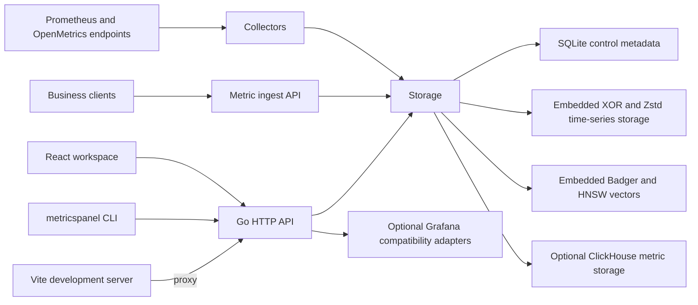

# Architecture

MetricsPanel233 is a single-node Go service with a first-party browser workspace and a command-line client. The browser and CLI use the same HTTP API; the service coordinates Prometheus-compatible collection, queries and metric persistence. Optional Grafana compatibility is an adapter concern, not the foundation of the product UI.

## Runtime flow

In production, Vite output is embedded in the Go executable when it is built with the webui build tag. During local development, Vite serves the UI and proxies API, metrics, Prometheus and plugin asset requests to the Go service. Product pages use first-party `web/src/ui` primitives; Grafana-specific plugin and resource behavior belongs behind a replaceable compatibility boundary.

## Source ownership

| Path | Responsibility |
| --- | --- |
| cmd/metricspanel | CLI commands, server startup and composition |
| internal/server | HTTP route registration, handlers and API contracts |
| internal/store | SQLite control data, metric persistence and transactions |
| internal/collector | Scheduled scraping and direct database/service collection |
| internal/identity, internal/instance | Users, password hashes, browser sessions and organization membership |
| internal/localauth | HTTP wiring for `--auth=local`: setup, login/logout, session cookie use, role matrix and user administration |
| internal/querycontext, internal/promcompat, internal/expressions, internal/sqlframes | Query evaluation and result conversion |
| internal/grafana | Optional Grafana dashboard, annotation and resource compatibility |
| internal/plugins | Optional Grafana plugin catalog, package validation and runtime lifecycle |
| web/src/features | Browser product pages |
| web/src/grafana | Grafana compatibility and plugin runtime adapters; not the product design system |
| tests/integration | Real service integration against isolated Docker dependencies |

Tests are also colocated with Go packages and in web/test and web/e2e.

Product chrome, forms and dialogs use the first-party primitives in `web/src/ui`. Feature pages are loaded on demand;
opening business onboarding does not eagerly load the alert editor, SQL editor or plugin catalog. The retained SDK
theme and time/query contracts still use `@grafana/data`; this is a measured migration boundary, not a claim of zero
Grafana dependencies. Built-in panels render through `web/src/render` with direct uPlot, HTML and Canvas. Large
time-series models use a transferable Worker and min/max decimation. The optional plugin host and resource adapters
remain behind `web/src/grafana`. See the [project goals](project-goals.md).

## Authentication boundary

The existing single-workspace handlers remain unchanged. In `--auth=local` mode the CLI wraps them with
`internal/localauth`, which authenticates the request first, injects the current principal, applies the global
Admin/Editor/Viewer route matrix, and then forwards the request. Static SPA assets stay public so the login page can
load; `/api/`, `/prometheus/`, `/metrics` and plugin assets are protected. Browser sessions use an HttpOnly
SameSite=Lax cookie scoped to `/`; a configured Bearer token remains valid for CLI automation. The identity catalog is
a separate SQLite file so metric retention and control-plane migrations never touch credentials.

## Storage boundary

SQLite is the zero-configuration default. ClickHouse is optional for metric storage; the SQLite control database still stores configuration and resources. Backups of a configured service must include the control database, the identity catalog (`identity.db` in local-account mode) and its adjacent encryption key, plus the ClickHouse data and plugin directory when those features are in use. See the [README storage section](../README.md#storage-and-performance) for operational details.

## Compatibility claims

Grafana compatibility is version-scoped to the open-source Grafana 13.2.3 baseline. The [compatibility matrix](grafana-compatibility.md), [product parity status](grafana-product-parity.md) and narrower contract pages are the source for implemented behavior and outstanding gaps. A passing unit or API test does not by itself establish rendered browser or full-product compatibility.
